<!-- _class: lead -->
# Beyond the First Visit

CMAT attendance and mathematics outcomes. **Paper 2 — provisional scientific synthesis**, 26 October 2026. For research faculty and CMAT administration.

<!-- _footer: Source: Consolidation plan -->
<!-- Speaker notes: Integrated validation pending. -->

---
# Principal message

The strongest evidence distinguishes **zero recorded visits from initial use**. Adjusted outcome differences are sizeable, while positive-frequency increments are less precise and model-dependent. No causal benefits are identified.

<!-- _footer: Source: Paper 2.1 Wald/Holm and 10_benchmark -->
<!-- Speaker notes: Estimation, model selection and prediction are different layers. -->

---
# Why mathematics support matters

Learning centres supplement instruction amid different levels of preparation. Use is self-selected; non-engagement may reflect access barriers. Experiments and observational studies provide different types of evidence.

<!-- _footer: Source: Lawson et al. 2020; Mullen et al. 2024; Pugatch & Wilson 2018 -->
<!-- Speaker notes: Do not transport a randomized estimate from another institution. -->

---
# CMAT and the optional PPA1 activity

PPA1 provides **one optional three-CMAT-visit integration activity**. The study does not observe individual intentions, PPA eligibility or credit use. Three visits motivate an exploratory grouping, not a discontinuity design.

<!-- _footer: Source: Consolidation plan, 2026-10-26 -->
<!-- Speaker notes: Never identify PPA-induced or uninterested students from visit counts. -->

---
# Cohort and empirical design

First eligible MU attempt with CMAT coverage, context fixed effects, degree adjustment and professor-period clustered uncertainty. Primary outcomes: `Z_GRADE_PRIMARY`, `PASS`; numeric-only and administrative sensitivities differ in sample and target.

<!-- _footer: Source: Paper 2.1 specifications; consolidation plan -->
<!-- Speaker notes: All attendance and grades are recorded in the same term. -->

---
# Visit distribution and precision

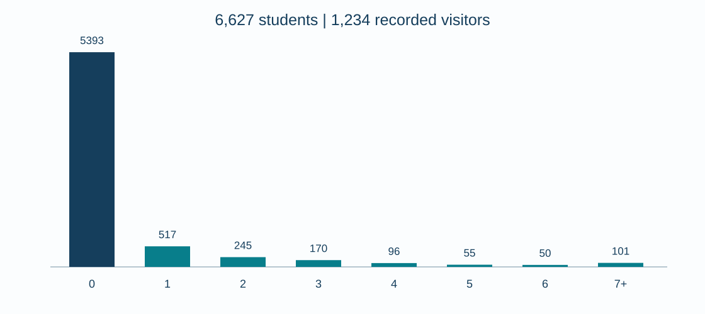

N=6,627; 190 professor-period contexts; 5,393 with zero visits and 1,234 with positive recorded visits. Sparse high-frequency support constrains fine-grained contrasts.

<!-- _footer: Source: 01_cohort_flow.csv; 10n_zero_inclusive_7plus_descriptives.csv -->
<!-- Speaker notes: The original all-period first eligible pool was 7,777. -->

---
# Raw grades and passing rates

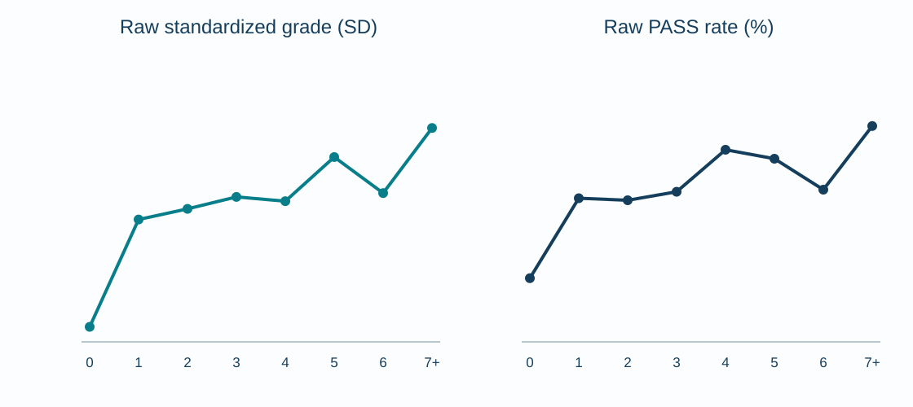

These are **unadjusted between-student means**, not longitudinal growth or experimental effects. The exact-frequency series is not strictly monotone.

<!-- _footer: Source: 10n_zero_inclusive_7plus_descriptives.csv -->
<!-- Speaker notes: The groups have strongly unequal denominators. -->

---
# Any attendance vs zero

Adjusted 1+ minus 0: **+0.361 grade SD**, CI [0.302,0.421], and **+15.29 PASS percentage points**, CI [12.44,18.15]. The 1+ pool is not exactly one visit.

<!-- _footer: Source: 10_benchmark_0_vs_1plus.csv -->
<!-- Speaker notes: 190 professor-period clusters; observational contrast. -->

---
# Wald and Holm inference

The original `0 | 1 | 2 | 3 | 4+` design has ten pairwise contrasts per outcome. Holm adjustment is within this specified family; the eight-category adjacent family and new PPA grouping are separate.

<!-- _footer: Source: Paper 2.1 tables 33 and 41 -->
<!-- Speaker notes: Nominal 95% confidence intervals are not simultaneous Holm CIs. -->

---
# Adjusted standardized-grade contrasts

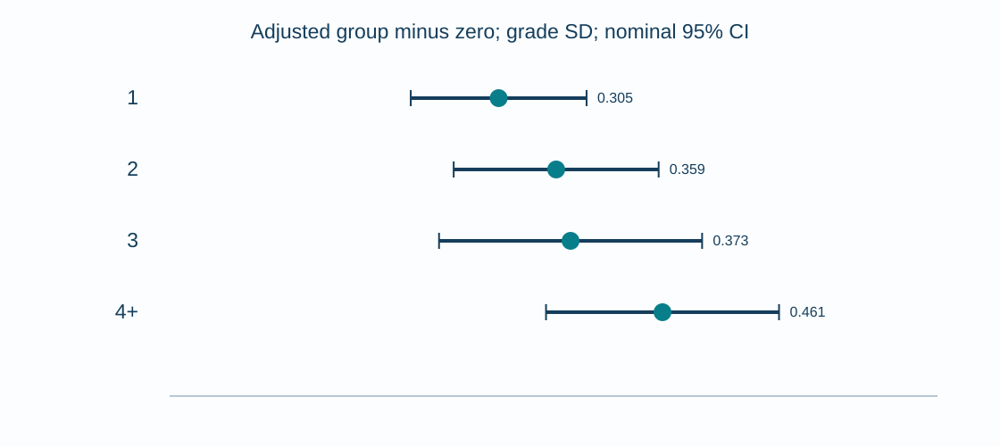

Each positive group differs from zero after ten-pair Holm correction. **No positive-versus-positive grade contrast** survives the ten-pair family.

<!-- _footer: Source: 33_exact_visit_groups_fe_pairwise.csv -->
<!-- Speaker notes: A nominally positive 1 versus 4+ difference does not survive Holm. -->

---
# Adjusted PASS contrasts

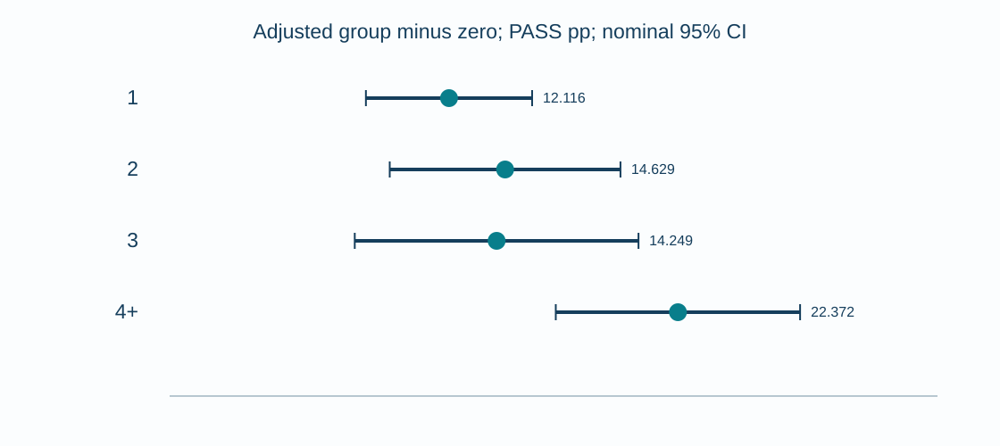

Every positive category differs from zero after Holm; **1 versus 4+** also survives (Holm p≈0.011). Other positive-pair differences do not.

<!-- _footer: Source: 41_exact_visit_groups_pass_fe_pairwise.csv -->
<!-- Speaker notes: Effects here are differences in percentage points, not odds ratios. -->

---
# PPA grouping: not yet validated

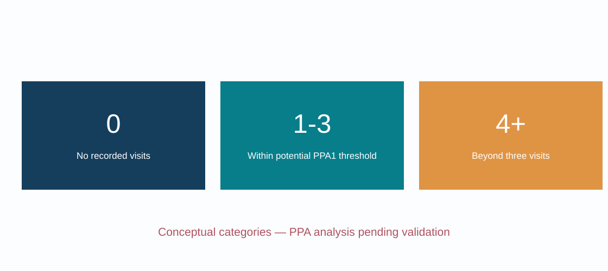

Primary `0 | 1–3 | 4+`; four-group sensitivity `0 | 1–3 | 4 | 5+`. **Pending validated adjusted estimates**. The figure is a grouping diagram, not a plotted result.

<!-- _footer: Source: PAPER2_CONSOLIDATION_PLAN.md -->
<!-- Speaker notes: Do not infer group effects from historical exact group coefficients. -->

---
# Two-part first/additional visits

Adjusted working model: Z first-visit **+0.307 SD**, additional-visit slope **+0.036 SD**; PASS first **+11.92 pp**, extra **+2.23 pp**. The common post-first slope is imposed and top-coded at 7+.

<!-- _footer: Source: two_part_attendance_z_pass.csv -->
<!-- Speaker notes: Two-term Holm correction is separate from pairwise families. -->

---
# Five fitted curve families

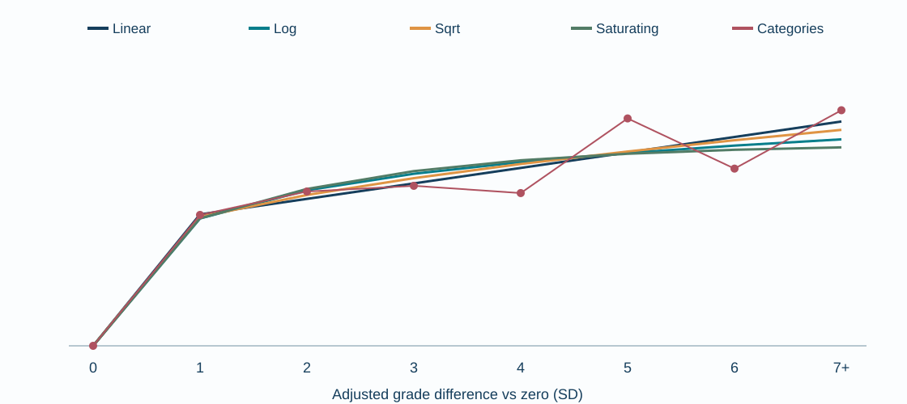

Linear, log, square-root and saturating fits impose different increment shapes; categorical effects do not. Slightly better in-sample AIC or grouped validation does not prove causal diminishing returns.

<!-- _footer: Source: attendance_curves/adjusted_curves_cluster_ci.csv -->
<!-- Speaker notes: Saturating parameter lambda was fixed in protocol. -->

---
# Five-to-six dip: broad uncertainty

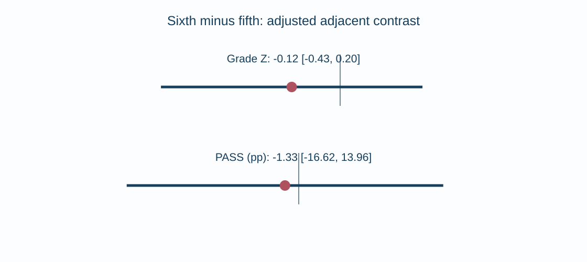

Sixth minus fifth adjusted contrast: grade **−0.117 SD**, CI [−0.433,+0.199]; PASS **−1.33 pp**, CI [−16.62,+13.96]. Neither survives seven-adjacent Holm. N5=55, N6=50.

<!-- _footer: Source: attendance_curves/adjacent_differences_holm.csv -->
<!-- Speaker notes: A negative point is not evidence that a sixth visit harms students. -->

---
# Fused-lasso boundary stability

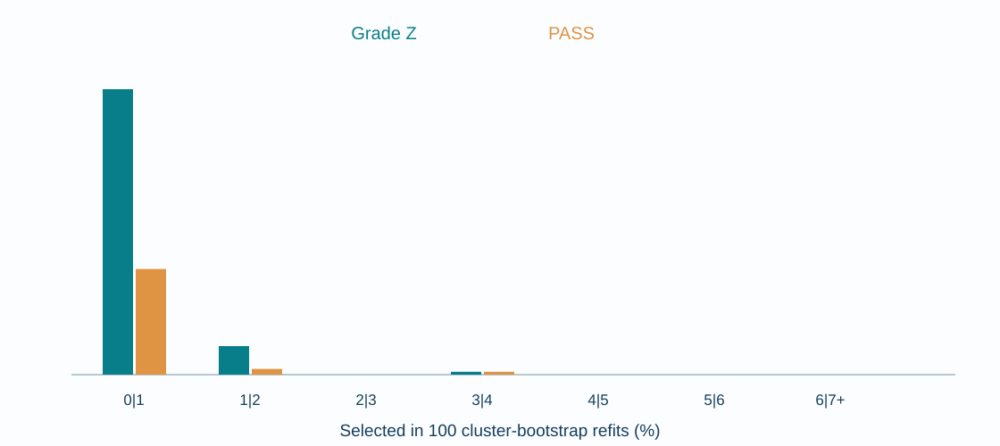

Grade discovery selects `[0] | [1–7+]`; 0|1 boundary appears in **100/100** cluster bootstrap refits. PASS one-SE-style selection fuses all counts, although its 0|1 boundary appears 37/100 times.

<!-- _footer: Source: fused 7plus blocks and boundary_stability CSVs -->
<!-- Speaker notes: Stability is algorithmic selection frequency, not truth probability. -->

---
# Internally held-out grade comparison

Reserved n=1,952 in 57 contexts: discovered Z group 1+ minus zero **+0.264 SD**, CI [0.150,0.377]. PASS has no selected boundary, so no comparable selected Wald contrast. Not an external or prospectively untouched replication.

<!-- _footer: Source: 7plus_z_grade_primary_holdout_wald.csv -->
<!-- Speaker notes: Research-wide outcome exploration preceded this particular split. -->

---
# Mixtures and skew-normal alternatives

Historical EM Gaussian mixtures and skew-normal fits test distributional adequacy under different outcome encodings. A better K=2 likelihood does **not** identify two student types or even two visible modes. Prospective modality test remains pending.

<!-- _footer: Source: Distributional branch results/paper21/tables/37–52 -->
<!-- Speaker notes: Administrative imputation can introduce mass points. -->

---
# Observed outcomes and administration

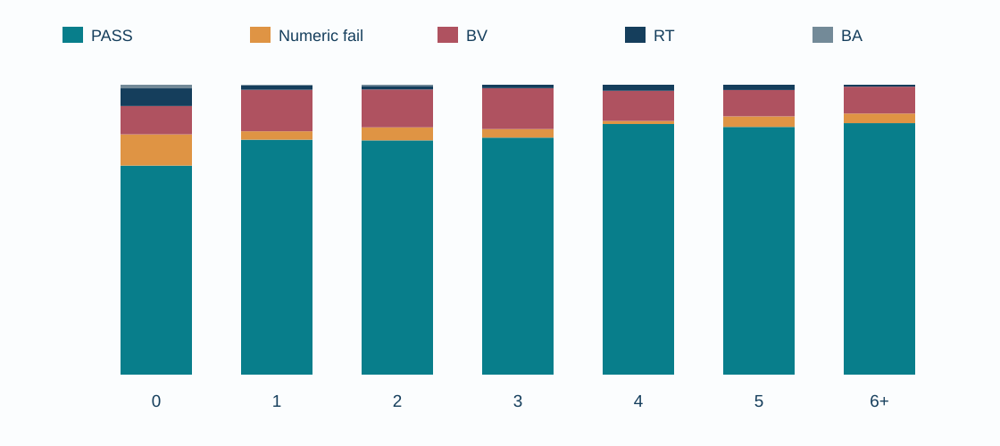

PASS, numeric fail, BV, RT and BA are different observed states. Numeric-only grades exclude administrative outcomes; primary Z applies defined imputation. Combining these populations changes the estimand.

<!-- _footer: Source: 10d_zero_inclusive_exact_administrative_composition.csv -->
<!-- Speaker notes: These shares are descriptive; all five states are exclusive. -->

---
# In-sample Shapley fit attribution

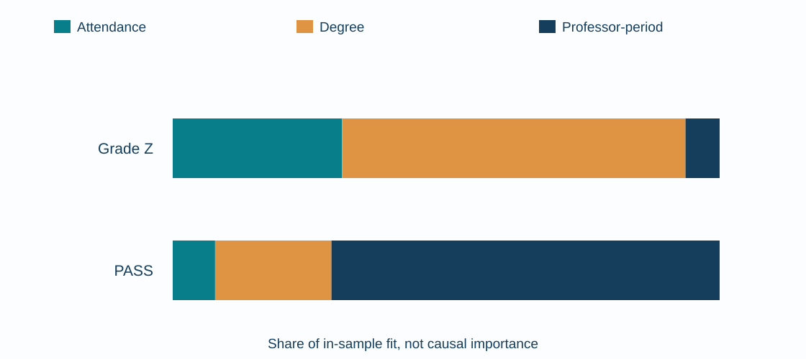

Model D: attendance accounts for approximately **31% of grade R²** and **8% of PASS R²**. Degree dominates grade fit; professor-period dominates PASS fit. These are not causal contributions.

<!-- _footer: Source: shapley_importance/in_sample_shapley_12_models.csv -->
<!-- Speaker notes: Model R² is only .058 for grade and .172 for PASS. -->

---
# Out-of-context predictive skill

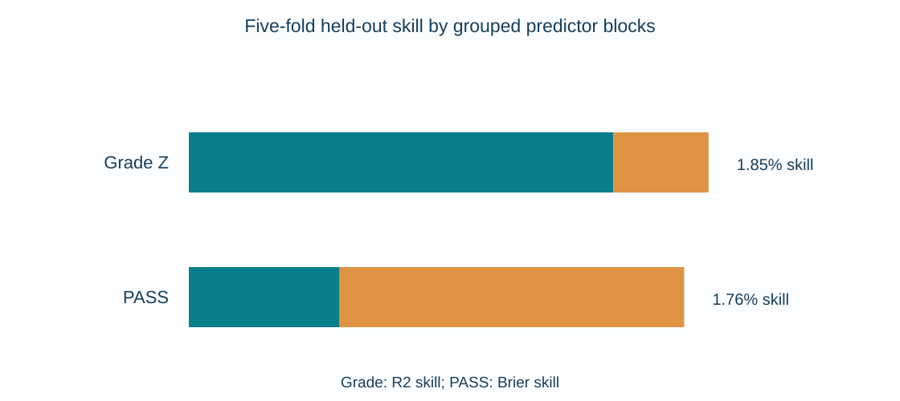

Five-fold professor-period-held-out analysis: grade R² skill **1.85%**, PASS Brier skill **1.76%**. Test-context FE indicators are unavailable. These are retrospective predictions, not actionable start-of-term warnings.

<!-- _footer: Source: shapley_importance/out_of_context_shapley.csv -->
<!-- Speaker notes: The two percentages use different loss functions. -->

---
# Synthesis and next study

Supported: large adjusted zero/initial separation, uncertain exact increments, a stable grade-selection cut and heterogeneous outcome composition. Next: validate PPA groups, audit cohort encoding, record prior readiness and visit timing, and prospectively test encouragement.

<!-- _footer: Source: Integrated synthesis, provisional, 2026-10-26 -->
<!-- Speaker notes: Administration should improve measurement without claiming an intervention effect. -->

---
<!-- _class: appendix -->
# Appendix A — evidence hierarchy

Primary: historical FE/Wald/Holm contrasts. Exploratory: PPA grouping pending; two-part and attendance curves; fused lasso; mixture diagnostics; Shapley and retrospective skill. These are **different estimands**, not independent confirmatory replications.

<!-- _footer: Source: Consolidation plan -->
<!-- Speaker notes: Preserve methodological hierarchy. -->

---
<!-- _class: appendix -->
# Appendix B — cohort numbers

Eligible first MU attempts across all historical periods: **7,777**; covered analysis: **6,627**. Exact n: 0=5393, 1=517, 2=245, 3=170, 4=96, 5=55, 6=50, 7+=101. 190 professor-period contexts.

<!-- _footer: Source: 01_cohort_flow.csv; 10n_zero_inclusive_7plus_descriptives.csv -->
<!-- Speaker notes: The terminal category is top-coded. -->

---
<!-- _class: appendix -->
# Appendix C — multiplicity

Wald tests compare context-adjusted µ(i)−µ(j) using clustered standard errors. Original historical ten-pair family, separately declared seven-adjacent family and two-term piecewise family require **distinct Holm corrections**.

<!-- _footer: Source: Paper 2.1 tables 33 and 41; Holm (1979) -->
<!-- Speaker notes: Nominal CI and Holm-adjusted p-values must be distinguished. -->

---
<!-- _class: appendix -->
# Appendix D — piecewise formula

`Y=alpha_context + gamma_degree + beta_0 ANY_VISIT + beta_plus EXTRA + error`. `ANY_VISIT=1(K>=1)`; `EXTRA=max(min(K,7)-1,0)`. Z betas 0.30656/0.03609; PASS betas 0.11923/0.02225.

<!-- _footer: Source: two_part_attendance_z_pass.csv -->
<!-- Speaker notes: Do not interpret beta_plus as a separate estimate for each visit. -->

---
<!-- _class: appendix -->
# Appendix E — shape-selection sensitivity

Z AIC: linear **18753.43**, log 18753.99, sqrt 18753.62, saturating 18754.40, categorical 18762.27. Out-of-context Z R² skill across shapes 0.01630–0.01692; differences are small.

<!-- _footer: Source: model_comparison_in_sample.csv; group_heldout_shape_cv.csv -->
<!-- Speaker notes: In-sample fit and held-out skill are different criteria. -->

---
<!-- _class: appendix -->
# Appendix F — fused protocol

Discovery n=4,675 / 133 contexts, reserve n=1,952 / 57 contexts; 100/100 bootstrap retunings successful. Z selected 0|1 in 100%. PASS all-fused under one-SE-style heuristic but **128/128** by exhaustive discovery BIC.

<!-- _footer: Source: 2026-10-07_fused_lasso_100_bootstrap_results.md -->
<!-- Speaker notes: Selection depends strongly on PASS heuristic. -->

---
<!-- _class: appendix -->
# Appendix G — distributions

Numeric complete-case BIC prefers GMM K=2 vs single skew-normal in groups 0,1,2; skew-normal K=1 in 3,4,5,6+. Held-out log predictive density also varies. Do not infer underlying social subgroups.

<!-- _footer: Source: 47_complete_case_skewnormal_vs_gmm.csv; 50_complete_case_skewnormal_vs_gmm_cross_validation.csv -->
<!-- Speaker notes: Sparse frequencies and grade ceilings affect fits. -->

---
<!-- _class: appendix -->
# Appendix H — provenance and readiness

Paper 2.1 `1546c594…`; fused `29810a86…`; mixture `b1cace12…`; Shapley `5915976f…`. **Claims matrix, integrated manuscript, validated PPA grouping pending at deck authoring.** No submission-readiness claim.

<!-- _footer: Source: GitHub source tips verified 2026-10-26 -->
<!-- Speaker notes: Administrator and methods agent must approve evidence. -->